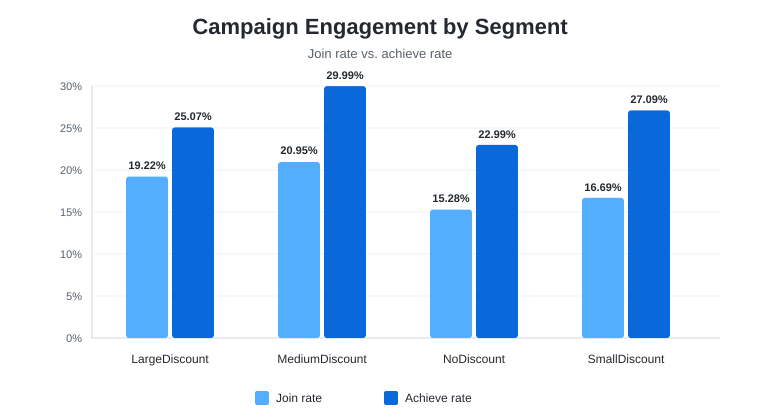
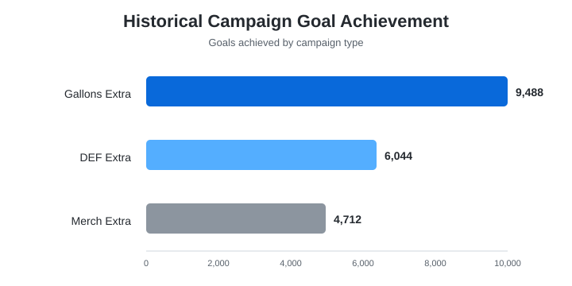
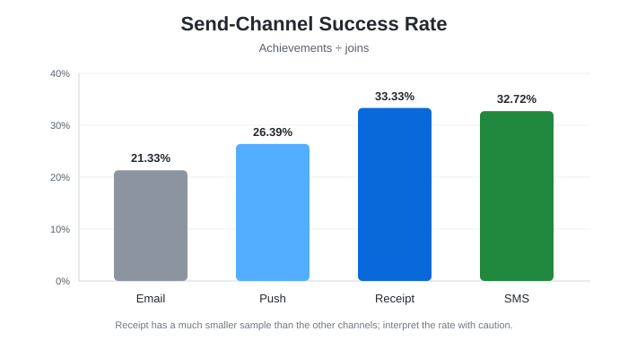

# Love's Customer Campaign & Segmentation Analytics

A portfolio-ready reconstruction of a customer analytics case competition project using Python, pandas, NumPy, Matplotlib, Seaborn, and Excel-style KPI analysis.

The project combines driver, campaign, product-sales, store, and three-year aggregate data to answer a practical business question: **how can Love's improve campaign targeting, customer engagement, and promotional efficiency?**

<p align="center">
  
</p>

## Project at a glance

| Data source | Scale |
|---|---:|
| Drivers | 20,000 |
| Campaign records | 409,091 |
| Monthly product-sales records | 2,453,789 |
| Stores | 700 |
| Customer segments | 4 |
| Campaign types | 3 |

The analysis links the five source tables primarily through `DRIVER_ID`, with `MOSTVISITEDSTORE` connected to `STORE_CODE` for geographic analysis.

## Key findings

- **MediumDiscount was the strongest engagement segment**, with a **20.95% join rate** and **29.99% achieve rate**. It also had the highest average campaign-month fuel gallons (**939.71**) and merchandise sales (**$95.49**).
- **Gallons Extra led historical goal achievement**, with **9,488 goals achieved** across **173,054 participant records** and **$313,583.34** in campaign cost.
- **DEF Extra produced the strongest incremental fuel-gallon and store-visit impact** in the original campaign comparison, while **Merch Extra** was strongest for merchandise-focused impact.
- **Receipt had the highest observed achievement-per-join rate (33.33%)**, but its sample was very small. SMS was next at **32.72%**, followed by Push at **26.39%** and Email at **21.33%**.
- Driver age had essentially **no meaningful relationship with gallons fueled per visit**, supporting a shift from demographic assumptions toward behavioral and campaign variables.

## Business questions

The notebook addresses eight questions:

1. Which campaign creates the strongest incremental impact?
2. How does the merchandise campaign affect product sales?
3. How do join and achieve rates vary by segment?
4. What do total and monthly sales reveal about each segment?
5. Which campaign send channels perform best?
6. What does historical campaign performance suggest?
7. Do customer segments differ geographically?
8. Does driver age relate to gallons fueled per visit?

## Repository structure

```text
.
├── README.md
├── requirements.txt
├── .gitignore
├── NOTICE.md
├── assets/
│   ├── segment_engagement.svg
│   ├── channel_success.svg
│   └── historical_goals.svg
├── data/
│   └── README.md
├── docs/
│   ├── data_dictionary.md
│   ├── methodology.md
│   └── reconstruction_notes.md
├── notebooks/
│   └── loves_customer_segmentation_analysis.ipynb
└── src/
    └── analysis.py
```

## Analysis workflow

**1. Data validation**  
Check key coverage, unmatched records, store mappings, and driver consistency across source tables.

**2. Campaign engineering**  
Calculate incremental fuel gallons, store visits, merchandise sales, campaign cost, participation, achievement, and impact-per-dollar measures.

**3. Customer segmentation**  
Compare `NoDiscount`, `SmallDiscount`, `MediumDiscount`, and `LargeDiscount` on campaign participation and transactional behavior.

**4. Product and sales behavior**  
Analyze total and monthly product sales across segments and compare promotional-period behavior.

**5. Channel effectiveness**  
Measure achievement-per-join performance across Email, Push, Receipt, and SMS.

**6. Geographic and demographic checks**  
Connect most-visited stores to divisions and test age against average gallons per visit.

## Results

### Segment engagement

<p align="center">
  
</p>

| Segment | Join rate | Achieve rate | Avg. fuel gallons | Avg. merch sales |
|---|---:|---:|---:|---:|
| LargeDiscount | 19.22% | 25.07% | 822.52 | $59.60 |
| MediumDiscount | **20.95%** | **29.99%** | **939.71** | **$95.49** |
| NoDiscount | 15.28% | 22.99% | 505.57 | $46.67 |
| SmallDiscount | 16.69% | 27.09% | 680.04 | $56.37 |

### Historical campaign performance

<p align="center">
  
</p>

| Campaign | Goals achieved | Participant records | Total campaign cost |
|---|---:|---:|---:|
| Gallons Extra | **9,488** | **173,054** | $313,583.34 |
| DEF Extra | 6,044 | 155,299 | $64,078.00 |
| Merch Extra | 4,712 | 80,738 | $36,270.20 |

### Send-channel success

<p align="center">
  
</p>

Receipt shows the highest achievement-per-join rate, but it has far fewer observations than Push, so the result should be interpreted with sample size in mind.

## Recommendations

- Prioritize **MediumDiscount** customers for high-value campaign targeting.
- Use **campaign-specific objectives** rather than treating every campaign as interchangeable.
- Treat **Gallons Extra** as a benchmark for historical engagement and achievement.
- Tailor send channels by segment, while considering sample size and reach.
- Use behavioral variables such as campaign type, fuel activity, merchandise activity, visits, and prior engagement instead of relying heavily on age.
- Use A/B tests and tiered rewards to optimize incentive value and campaign cost.
- Use division-level location patterns for targeting, but avoid over-interpreting weaker state-level differences.

## Reproducibility

The raw CSV files are **not committed** to this repository. They were supplied for an academic case competition and may be subject to sharing restrictions.

To run the notebook locally, place the five original CSV files in `data/` using the names documented in [`data/README.md`](data/README.md), then install the dependencies:

```bash
pip install -r requirements.txt
jupyter notebook notebooks/loves_customer_segmentation_analysis.ipynb
```

## Reconstruction note

The original `.ipynb` available from the project appeared to be preliminary brainstorming work containing sample/hard-coded data. This repository therefore reconstructs the analysis from the original CSVs and final project write-up. Where the final report did not preserve enough code to reproduce a figure exactly, the notebook labels that limitation instead of hard-coding an unsupported result.

See [`docs/reconstruction_notes.md`](docs/reconstruction_notes.md) for details.

## Tech stack

`Python` · `pandas` · `NumPy` · `Matplotlib` · `Seaborn` · `Jupyter` · `Excel-style KPI analysis`

---

**Project:** Love's Case Competition — Customer Campaign & Segmentation Analytics  
**Focus:** Customer segmentation, campaign measurement, behavioral analytics, KPI engineering, and business recommendations
